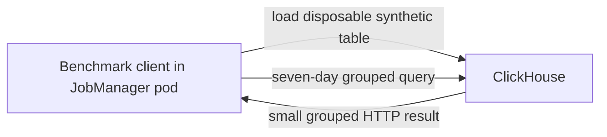

# ClickHouse query benchmark: 2026-11-03

## Goal

Verify warmed dashboard-style grouped query latency over synthetic stored
data, separately from Kafka-to-Flink ingestion and fact visibility.



Kafka, Flink operators and PostgreSQL are not in the timed query path.

## Targets

- p95 client HTTP round-trip below 500 ms.
- Reproducible generated/stored row counts, partition information and
  p50/p95/p99 after warmup.

## Test setup

- Owned `rpp-stage6-single` diagnostic profile: one 4-CPU/6144-MiB node.
- ClickHouse 25.8.16.34, container limit 2 CPUs/2 GiB and 8-GiB PVC.
- 100000 generated/stored rows, 1000-row insert batches, 30 warmed samples.
- Four monthly partitions (`202608` through `202611`), four active parts,
  2922038 bytes on disk; ordered by day, dimensions, event time and event ID.
- Source based on Stage 6 commit `6e2a23f` with a dirty worker-packaging fix.
  Complete source/image provenance was not captured in the raw query report.
- Client's 20 host-visible logical CPUs and 1342177280-byte cgroup limit
  describe the JobManager client, **not ClickHouse's allocation**.

### Commands and sequence

Use the [shared cleanup guidance](2026-11-04-low-memory.md#reclaim-memory-before-starting)
before running. `make doctor` and `make ci` validate tooling/source first.

The existing internal single-cluster deployment with streaming/analytics
enabled in ignored profile settings **passed**, as did embedded smoke:

```bash
MINIKUBE_PROFILE=rpp-stage6-single MINIKUBE_CPUS=4 MINIKUBE_MEMORY=6144 \
  bash scripts/local-dev.sh up
```

The recorded benchmark command **passed**, using credentials already mounted
inside the JobManager without printing them:

```bash
kubectl --context rpp-stage6-single -n apps exec -i deployment/stream-processor-jobmanager \
  -- python - < modules/realtime-analytics/benchmark.py
```

The public equivalent is `make -C modules/realtime-analytics benchmark`,
after following the [module's loopback forwarding and credential setup](../../../modules/realtime-analytics/README.md).
That host-client path was not the path measured here.

After verification the diagnostic profile was stopped, preserving its data:

```bash
minikube stop -p rpp-stage6-single
```

## Achieved

| Metric | Measured |
|---|---|
| p50 | 5.53 ms |
| p95 | 6.65 ms |
| p99 | 24.15 ms |
| Target | Passed: p95 below 500 ms |

The [raw JSON](2026-11-03-clickhouse-query.json) retains exact values.
This is a small warmed query benchmark, not production capacity proof or a
pipeline-latency result.

## Related functional verification

Separately, a dirty-source rebuild restored a retained Flink checkpoint and
the owned profile was deleted/recreated. Timed fixtures produced 28 distinct
facts, 26 EUR minute payments, revision 2 and one too-late event. Flink was
RUNNING with 13 completed checkpoints and none failed. Deleting only the
ClickHouse pod preserved all 28 facts on the existing PVC.

Those checks are correctness/recovery evidence, not timed throughput tests.
The host had about 8.8 GiB available after verification. Full three-cluster
acceptance was not completed.
