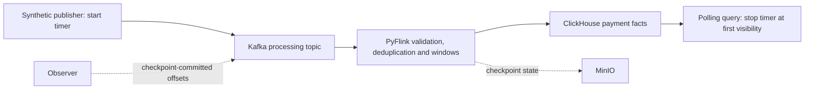

# Low-memory pipeline benchmark: 2026-11-04

## Goal

Measure the asynchronous analytics path on a constrained laptop: can the
pipeline sustain a short 50 events/s baseline within a 2-second p95 visibility
target, and what happens when offered load increases to 100 events/s?
Keep correctness, memory safety and failed acceptance visible.



PostgreSQL, the payment API and outbox are deployed supporting workloads but
are **not in this measured data path**. Event-time aggregate completion and
dashboard query latency are not the fact-visibility metric.

## Targets

| Criterion | Target |
|---|---|
| Baseline | 50 events/s for 120 seconds; 6000 unique facts |
| Producer pacing | Actual baseline rate within 1% below scheduled rate |
| Fact visibility | Baseline p95 at most 2 seconds |
| Approximately non-growing backlog | Baseline slope at most 1 event/s, allowing sampling noise |
| Terminal baseline backlog | At most 100 unobserved facts |
| Stress | Offer 100 events/s for 90 seconds; report overload separately |
| Reconciliation | All 16000 facts, including warmup, visible by final drain |
| Recovery stability | New completed checkpoints, no additional failed checkpoints or job recovery |
| Duration | Under seven minutes for measurement; build/deployment excluded |

The schedule is 20-second warmup at 50 events/s, 120-second baseline,
10-second drain, 90-second stress and 45-second final drain: 285 seconds.
The short baseline is not a long-term capacity certification.

## Test setup

### Hardware and deployment

- Linux on WSL2; host-visible RAM about 15.5 GiB.
- One dedicated Minikube Docker node: `rpp-stage6-lowmem`, 4 CPUs/6144 MiB.
- Payment stack, local Kafka/PostgreSQL, Flink, MinIO and ClickHouse share
  this node. Observability backends are disabled.
- `runtime_profile: low-memory`; one processing parallelism slot. Standard
  profile defaults, node minimums and host safety reserve are unchanged.
- ClickHouse version 25.8.16.34; local persistent storage, not replicated HA.
- Source was dirty during development on the Stage 6 branch, based on
  `fd94a47f4611d82d6ef11b1506080cfa161e7614`. The raw report did not capture a
  complete source diff, image digests, Kafka version or per-container CPU
  observations. This limits exact historical reproducibility; do not infer
  those identities from a later checkout.

| Role | Process budget | Container memory request / limit | Observed cgroup peak |
|---|---|---|---|
| JobManager | 768m | 768Mi / 1024Mi | 429.6 MiB |
| TaskManager | 1280m | 1280Mi / 2048Mi | 870.5 MiB |
| ClickHouse | Upstream settings | 768Mi / 2048Mi | 2048 MiB |

The post-load Docker node snapshot was 5.48 GiB of its 6-GiB cap.
Flink reported no OOM or memory-limit events. ClickHouse reported 451
memory-limit `max` events, but no OOM/OOM-kill events. Cgroup memory includes
charged cache, not just application heap. This evidence does not justify
cutting ClickHouse's limit further.

### Reclaim memory before starting

Inventory first; do not stop or delete another person's environment:

```bash
minikube profile list
docker stats --no-stream
free -m
```

For each **owned, disposable or temporarily unused** profile, stop it by exact
name. For example, the prior diagnostic profile can be stopped non-destructively:

```bash
minikube stop -p rpp-stage6-single
```

Stopping nodes releases running workload memory while retaining local data.
Do not use `minikube delete --all`, `docker system prune`, force-kill WSL, or
delete profiles just to silence an allocation failure.

If an owned three-cluster test base is explicitly approved for permanent data
disposal, use its lifecycle in this order while its nodes are reachable:

```bash
make dev-down DEV_PROFILE=rpp-stage6-perf
make cluster-down DEV_PROFILE=rpp-stage6-perf
free -m
```

These commands destroy application/database data and then delete nodes.
They are **not prerequisites for a rerun**; prefer stopping unrelated owned
workloads or reusing an existing test environment. Starting stopped nodes
just to destroy them also consumes memory: do not do so on an unsafe host.
Stopped profiles already consume no running node RAM, so deleting them mainly
reclaims disk. Stop only your own browser port-forwards, if any.

### Public three-cluster sequence: planned, not executed

Follow the [benchmark README](../README.md#quick-start) for the exact Make
sequence: `make doctor`, `make ci`, memory preflight, `make dev-up`, smoke,
status, benchmark, and cleanup.

On this host, the actual command:

```bash
make streaming-benchmark-preflight DEV_PROFILE=rpp-stage6-perf DEV_CONFIG=templates/analytics-benchmark-topology.json
```

**Failed safely:** 11946 MiB available versus 14336 MiB required
(A=6144, B/C=3072 each, plus 2048 MiB reserve). No clusters were started by
that attempt. The low-memory topology retains the same node caps, so it
does not bypass that preflight. There is no three-cluster performance result.

### Executed single-cluster diagnostic sequence

The public benchmark target requires three running clusters. This historical
diagnostic instead used the existing internal single-cluster deployment
script; it is not a new public single-cluster Make workflow.

1. `make ci` and focused profile/benchmark tests passed.
2. An unused `.local/rpp-stage6-lowmem/events.tfvars.json` was prepared with:

    ```json
    {
      "streaming_enabled": true,
      "analytics_enabled": true,
      "runtime_profile": "low-memory"
    }
    ```

3. Deployment and embedded smoke checks **passed**:

    ```bash
    MINIKUBE_PROFILE=rpp-stage6-lowmem MINIKUBE_CPUS=4 MINIKUBE_MEMORY=6144 \
      bash scripts/local-dev.sh up
    ```

4. The following command completed in 285.35 seconds and correctly **returned
    nonzero** for failed acceptance. Its JSON is retained
    [alongside this report](2026-11-04-low-memory.json):

    ```bash
    kubectl --context rpp-stage6-lowmem -n apps exec -i deployment/flink-jobs-jobmanager \
      -- env PYTHONPATH=/opt/job python - < modules/flink-jobs/benchmark.py
    ```

5. After collecting node/container memory and pod status, the following
   **passed** and printed a persistent savepoint URI:

    ```bash
    make streaming-stop MINIKUBE_PROFILE=rpp-stage6-lowmem
    ```

6. With `STREAMING_RESTORE_PATH` set to that exact URI, dirty-source rebuild,
    restored job readiness and smoke **passed**:

    ```bash
    MINIKUBE_PROFILE=rpp-stage6-lowmem STREAMING_RESTORE_PATH=<savepoint-uri> \
      bash scripts/local-dev.sh update
    ```

    Replace the placeholder before executing; never type angle brackets as
    shell redirection.
7. Final `make ci` and changed-file checks **passed**. The restored job was
    RUNNING before non-destructive cleanup:

    ```bash
    minikube stop -p rpp-stage6-lowmem
    ```

    The profile and data were retained, other profiles remained stopped, and
    host available memory recovered to approximately 11.4 GiB.

## Achieved

| Measurement | 50 events/s baseline | 100 events/s stress |
|---|---|---|
| Actual producer rate | 50.00 events/s | 100.01 events/s |
| Facts confirmed after drain | 6000 / 6000 | 9000 / 9000 |
| Throughput including visibility tail | 48.45 events/s | 82.61 events/s |
| Visibility p50 / p95 / p99 | 3.51 / 4.73 / 5.13 seconds | 12.99 / 18.13 / 19.58 seconds |
| Visibility backlog slope | 0.045 events/s | 13.90 events/s |
| Maximum sampled visibility backlog | 219 | 1568 |
| Checkpoint-committed Kafka lag: first / last / max | 599 / 551 / 609 | 4 / 1754 / 2964 |

All 16000 unique facts, including 1000 warmup events, were visible after final
drain. The job had 30 completed checkpoints, zero failed checkpoints, zero
restorations and no pod restarts during measurement.

**Overall result: failed acceptance.** The baseline latency exceeded two
seconds; the approximately stable backlog does not override that failure.
Stress built backlog and subsequently drained. The report's throughput
including the visibility tail is not a steady-state maximum.

## Metric definitions and limitations

- Latency starts at the producer send attempt and ends when the polling query
  first sees the unique fact using `FINAL`. It includes nominal one-second
  polling, query and observation overhead: an upper-bound visibility measure,
  not exact persistence time or payment authorization latency.
- Kafka lag uses end offsets minus Flink checkpoint-committed offsets, which
  naturally produces a checkpoint sawtooth. For fresh partitions with no
  commit, count from the earliest retained offset and disclose that policy.
- Non-growing backlog uses this run's sent unique events minus visible facts,
  not checkpoint-committed lag. Unconfirmed facts at a deadline mean undrained
  backlog, not proven permanent loss.
- The raw JSON preserves samples and acceptance failure. It has no credentials
  or real payment data; run/job/event identities are synthetic.
- Earlier diagnostic attempts exposed missing stdin `PYTHONPATH` and absent
  fresh-partition commits. Those setup defects were fixed before this run.
- No three-cluster, separate-server, whole-cluster outage, authorization TPS,
  sustained-duration capacity or exactly-once external-write claim is made.

## Follow-up

Investigate the ingestion/observation bottleneck before lowering memory further.
Repeat with unchanged targets and record source/image identity and resources
for comparisons. Keep three-cluster safety reserves and node minimums intact.

See [operational recovery](../../../docs/runbooks/clickhouse-analytics.md),
[profile settings](../../../modules/flink-jobs/chart/README.md#opt-in-low-memory-runtime)
and the separate [query benchmark](2026-11-03-clickhouse-query.md).
